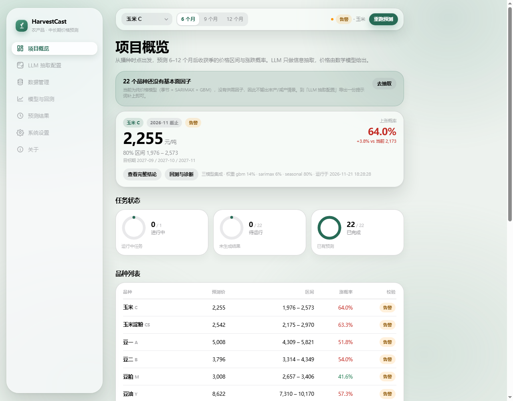
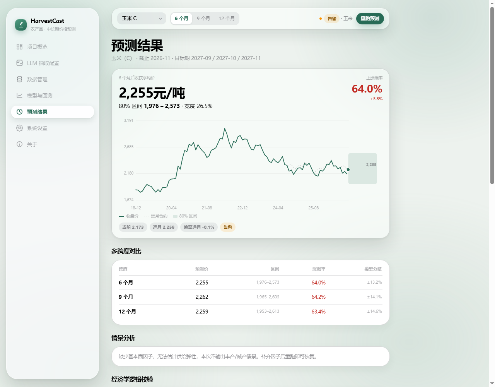
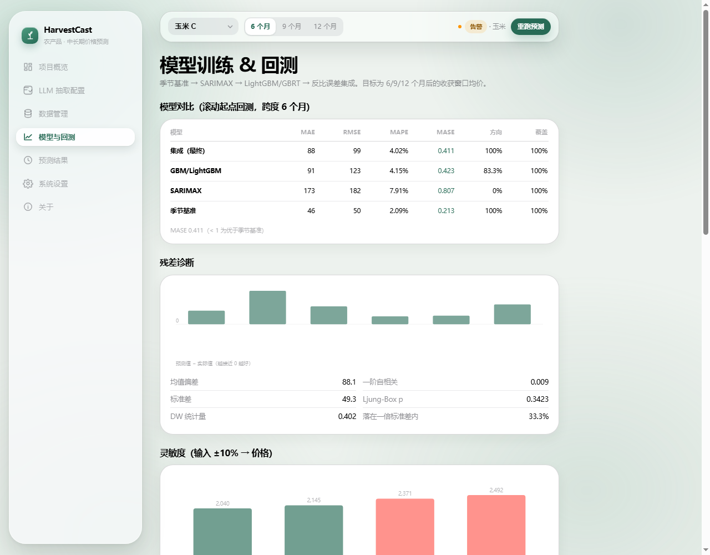
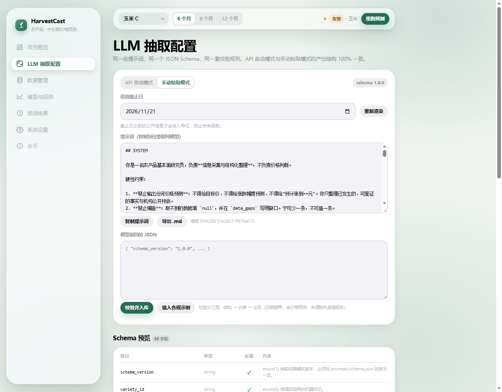
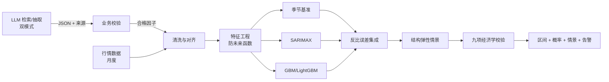

# HarvestCast · 农产品中长期价格预测系统

> 在**播种时点**回答一个问题：6–12 个月后的**收获季**，这个品种的价格大概落在哪个区间，涨的概率有多大。

[](./LICENSE)
[](https://github.com/YUN2023c/HarvestCast/wiki)
[](https://www.python.org/)
[](./requirements-optional.txt)
[](#方法论)
[](./web/index.html)

**摘要**：**HarvestCast** 是一个开源（MIT）的**农产品中长期价格预测系统**：以公开期货行情与基本面因子为输入，用季节基准、SARIMAX、梯度提升树三模型集成，输出 22 个中国农产品期货品种 **6–12 个月后收获季**的价格区间与涨跌概率。运行时零第三方依赖，42 项单元测试，LLM 仅做信息抽取、绝不预测价格。

> **HarvestCast** is an open-source (MIT) long-horizon agricultural commodity price forecasting system. It ensembles a seasonal baseline, SARIMAX and gradient-boosted trees to output probabilistic harvest-season price ranges (80% intervals, up/down probability) for 22 Chinese agricultural futures varieties, 6–12 months ahead. Zero runtime dependencies; 42 unit tests; the LLM only extracts fundamentals and never predicts prices.

**关键词 / Keywords**：农产品价格预测 · 中长期价格区间 · 收获季定价 · 供需基本面 · 结构化抽取 · SARIMAX · LightGBM · 可解释量化 · agricultural commodity price forecasting · long-horizon forecast · supply-demand fundamentals · LLM structured extraction · seasonal baseline · probabilistic forecast

---

## 界面预览

| 项目概览 | 预测结果 |
|---|---|
|  |  |

| 模型与回测 | LLM 抽取配置 |
|---|---|
|  |  |

侧边导航在 ≥820px 固定左侧（240px 玻璃面板，选中态垂直 lens），<820px 收起为浮动按钮 + 左侧弹簧抽屉；
全部图表为手写内联 SVG，无图表库、无外部请求。

---

## 目录

- [这是什么](#这是什么)
- [核心设计：三条铁律](#核心设计三条铁律)
- [特性](#特性)
- [快速开始](#快速开始)
- [目录结构](#目录结构)
- [使用教程](#使用教程)
- [方法论](#方法论)
- [模型与评价](#模型与评价)
- [数据来源与授权风险](#数据来源与授权风险)
- [参考与数据来源](#参考与数据来源)
- [常见问题](#常见问题)
- [贡献指南](#贡献指南)
- [开源协议](#开源协议)
- [引用](#引用)

---

## 这是什么

HarvestCast 是一套**轻量、开源可商用、面向低波动农产品**的中长期价格预测系统。它不是高频交易系统，也不做分钟级择时；它解决的是农业生产与采购决策里最实际的那个问题——**今年秋天的收购价，大概在什么范围**。

| 维度 | 取值 |
|---|---|
| 预测目标 | 收获窗口（可跨 2–3 个月）的月度均价 |
| 预测跨度 | 6 / 9 / 12 个月（可配置） |
| 建模频率 | 月度（明确禁止 tick / 日线高频） |
| 输出 | 价格区间 + 涨跌概率 + 三情景 + 逻辑校验结论 |
| 运行时依赖 | **0 个第三方包**（行情抓取、建模、前端全部走标准库） |
| 初始数据 | 首次运行自动拉取真实行情（新浪日线），**不会用合成数据顶替** |
| 可选加速 | statsmodels / LightGBM / pandas / AKShare |
| 前端 | 单文件 HTML（液态玻璃 + 侧边导航，PC/移动自适应） |

覆盖 **22 个农产品品种**，按四类组织（新增品种见 [常见问题](#常见问题)）：

| 分类 | 品种 |
|---|---|
| 谷物 | 玉米 C、玉米淀粉 CS、粳米 RR、晚籼稻 LR、早籼稻 RI、强麦 WH |
| 油脂油料 | 豆一 A、豆二 B、豆粕 M、豆油 Y、棕榈油 P、菜粕 RM、菜籽油 OI、油菜籽 RS、花生 PK |
| 软商品 | 白糖 SR、棉花 CF、天然橡胶 RU |
| 生鲜 | 苹果 AP、红枣 CJ、生猪 LH、鸡蛋 JD |

---

## 核心设计：三条铁律

1. **LLM 绝不预测价格。**
   大模型只做「检索 → 抽取 → 结构化」，输出因子、来源、原文摘录、置信度。任何含「目标价 / 预计涨到」字样的产出会被业务校验层直接拒收。

2. **价格只能由数学模型给出。**
   季节基准、SARIMAX、GBM 三路并行，按误差反比集成，输出区间与概率，不追求单点精度。

3. **结果必须过经济学体检。**
   价格带、区间宽度、远月定价偏离、季节形状、情景单调性、MASE、样本长度、因子覆盖——九项检查，异常必须告警，不允许静默放行。

> 一个副作用值得提前说明：当模型跑不赢季节朴素基准时，系统会**主动告诉你**（MASE ≥ 1 触发告警）。多数农产品月度价格的长跨度预测本就接近随机游走，这个告警是特性，不是缺陷。

---

## 特性

| 特性 | 说明 |
|---|---|
| 文件式数据管线 | CSV/JSON 落盘，无数据库；写入原子替换且自动留 `.bak` |
| 初始行情引导 | 首次运行先取真实行情；通道全失败就报错，**绝不用合成数据顶替**；落地时自动隔离残留的合成因子 |
| 双模式 LLM 抽取 | API 自动模式 / 人工粘贴模式，共用同一提示词与 Schema，产出结构 100% 一致 |
| 严格的 Schema 契约 | JSON Schema 2020-12 + strict 三约束（`additionalProperties:false`、全字段 `required`、可空用 `[T,null]`） |
| 防未来函数 | 因子按发布日可见；滚动统计一律 expanding；目标与特征时间严格分离 |
| 三模型集成 | 权重来自滚动回测的反比 MSE，且只用「该时点之前」的误差 |
| 情景分析走结构弹性 | 不用树模型外推（树无法外推，极端情景响应会被压平），改由 OLS 弹性换算 |
| 全链路审计 | 每次数据写入、抽取入库、预测落盘都追加一行 `audit.log` |
| 协议干净 | 仅 MIT / BSD / Apache / PSF；明确排除 GPL/LGPL/AGPL |

---

## 快速开始

### Windows 一键启动

双击项目根目录的 **`start.bat`**（纯 ASCII，无中文输出）：

1. 检测 `python` / `py -3`；
2. **没有数据时先拉真实行情**（22 个品种，约 1–3 分钟），拉取失败就停下并给出提示，不会偷偷塞合成数据；
3. 跑一次首个可用品种的预测；
4. 后台启动本地服务，日志写入 `logs/server.log`；
5. 端口就绪后自动打开浏览器。

再次双击时若服务已在运行，只打开界面不会重复启动。设置环境变量 `HC_NO_BROWSER=1` 可只起服务、不弹浏览器（适合脚本/CI）。

### 手动启动

```bash
git clone https://github.com/YUN2023c/HarvestCast.git
cd harvestcast

# 1) 获取初始行情（首次必须；没有数据时预测会直接拒绝）
python -m src.cli init              # 全部 22 个品种
python -m src.cli init --variety corn,sugar   # 只拉指定品种

# 2) 跑一次完整预测（清洗 → 特征 → 三模型 → 集成 → 校验）
python -m src.cli predict --variety corn

# 3) 打开界面
python -m src.cli serve --port 8848
# 浏览器访问 http://127.0.0.1:8848
```

完全离线（无网络）时可显式生成合成数据，仅用于流程演示：

```bash
python -m src.cli init --allow-demo     # 或 python -m src.cli demo
```

要求 **Python ≥ 3.9**，无需 `pip install` 任何包即可跑通。想更快/更准可选装：

```bash
pip install -r requirements-optional.txt   # statsmodels, lightgbm, pandas, akshare
```

界面数据全部来自本地 API，**没有服务就如实报错**（带重试按钮），不会再内联一份旧数据冒充实时结果。

---

## 目录结构

```text
harvestcast/
├── config/
│   ├── varieties.json          # 品种主数据（收获月、合约周期、价格带、关键因子）
│   └── settings.example.json   # 参数模板（复制为 settings.json 后修改）
├── llms.txt                    # AI 引擎精选索引（GEO）
├── llms-full.txt               # 主文档全文合集（脚本生成）
├── prompts/
│   ├── extraction_prompt.md    # 唯一提示词模板（占位符渲染）
│   └── schema.json             # 抽取结果 JSON Schema（2020-12，strict 兼容）
├── src/
│   ├── core/
│   │   ├── numeric.py          # 纯 Python 数值基座（OLS / 正态 / ACF / Ljung-Box / 指标）
│   │   ├── timeutil.py         # 月序号口径、收获窗口吸附
│   │   └── config.py           # 路径与配置加载
│   ├── data/
│   │   ├── schema.py           # 数据契约（MarketRow / FactorRow / DatasetBundle）
│   │   ├── store.py            # CSV/JSON 原子写入 + 审计日志
│   │   ├── clean.py            # 月度聚合、补缺、MAD 去噪、单位归一、因子去重
│   │   ├── features.py         # 防未来函数特征工程 + 直接多步目标构造
│   │   └── ingest.py           # AKShare 适配器 + 合成数据生成器
│   ├── llm/
│   │   ├── prompt_builder.py   # 模板渲染 + SHA256 指纹
│   │   ├── jsonschema_lite.py  # 极简 Schema 校验（三层校验的第一层）
│   │   ├── client.py           # chat/completions 与 responses 两种接口形态
│   │   └── extract.py          # 业务校验 → 归一化 → 合并入库
│   ├── models/
│   │   ├── base.py             # Forecast 契约、样本切片、残差尺度
│   │   ├── seasonal.py         # 季节基准（必须被打败的下限）
│   │   ├── sarimax.py          # SARIMAX 条件最小二乘（可选 statsmodels 对照）
│   │   ├── gbm.py              # 内置 GBRT / 可选 LightGBM，直接多步
│   │   ├── ensemble.py         # 反比 MSE 集成、概率、情景
│   │   └── backtest.py         # 滚动起点回测、五类指标、残差诊断
│   ├── econ/
│   │   ├── elasticity.py       # 结构弹性估计（情景分析的依据）
│   │   └── validator.py        # 九项经济学逻辑校验
│   ├── server.py               # 本地 HTTP 服务（只读文件 + 触发任务）
│   └── cli.py                  # 命令行入口
├── web/index.html              # 单文件前端（内联示例数据）
├── tests/test_pipeline.py      # 31 个单测
├── docs/
│   ├── ARCHITECTURE.md         # 架构与校验矩阵
│   ├── RESEARCH.md             # 10 方向调研 + 开源项目与协议核验
│   ├── DATA_SOURCES.md         # 数据源与授权风险
│   └── UI_SPEC.md              # 设计系统与验收清单
├── data/                       # market / fundamentals / derived / output（运行后生成）
├── THIRD_PARTY_NOTICES.md
└── LICENSE
```

---

## 使用教程

### 1. 选品种、跑预测

```bash
python -m src.cli predict --variety corn --origins 8
```

输出示例：

```text
玉米（C） 截止 2026-11
目标期      2027-09 / 2027-10 / 2027-11
预测价格    2,472 元/吨   [2,243, 2,724] (80%)
当前/远月   2,588 / 2,560
上涨概率    27.3%   预期变动 -4.49%
模型权重    {'gbm': 0.44, 'sarimax': 0.34, 'seasonal_baseline': 0.22}
  情景 丰产  2,409   情景 平产  2,472   情景 减产  2,536
逻辑校验    warn  (warn=1, error=0)
```

### 2. 手工模式抽取基本面

```bash
# 导出提示词（含完整 Schema，可复制到任意联网模型）
python -m src.cli prompt --variety corn --as-of 2026-09-30

# 把模型返回的 JSON 存成文件后回填
python -m src.cli extract --variety corn --json-file data/output/pasted.json
```

入库会经过三层校验：**结构**（字段/类型/枚举）→ **约束**（正则/范围/数组长度）→ **业务**（日期不得晚于截止日、不得含价格预测表述、品种必须匹配、重复项去重）。低置信或无来源的记录不会进入训练集。

### 3. API 自动模式

```bash
export HARVESTCAST_API_KEY=sk-xxx
python -m src.cli api --variety corn
```

在 `config/settings.json` 中设置 `llm.api_style`：

- `chat`（默认）：`/chat/completions` + `response_format.json_schema`，兼容多数 OpenAI 风格端点；
- `responses`：`/responses` + `web_search` 工具，适合需要「联网 + 结构化」一步到位的场景。

> **能力边界**：纯 `chat/completions` 接口本身不联网。所谓自动模式依赖模型自带检索能力或上游网关代检索。模型不支持检索时，请用手工模式——两条路径的 Schema 与校验完全相同。

### 4. 界面

| 页面 | 你能做什么 |
|---|---|
| 项目概览 | 看各品种当前预测、任务状态环形进度、校验结论 |
| LLM 抽取配置 | 切换 API/手工模式、复制提示词、回填 JSON、看入库质量 |
| 数据管理 | 看行情快照、因子置信度与来源、覆盖率、清洗日志 |
| 模型与回测 | 看模型对比表、残差图、灵敏度、季节形状、特征重要性、弹性 |
| 预测结果 | 区间带图、多跨度对比、三情景、九项校验逐条结论 |
| 系统设置 | 运行环境、可选依赖、开源许可、参数 JSON |
| 关于 | 数据来源与授权、免责声明、版本信息 |

---

## 方法论

### 数据流



### 关键取舍

**为什么目标是「收获窗口均价」而不是某一天的收盘价？**
收获期本身横跨 2–3 个月，单点价格噪声大且不可操作；窗口均值对应真实的销售/采购决策，也让 MASE 的分母口径保持自洽。

**为什么用直接多步而不是递归预测？**
递归把每一步的误差反馈进下一步，6–12 个月后误差会被放大数倍。直接法对每个跨度单独训练，结构上不累积误差。

**为什么 SARIMAX 只做 AR + 季节 AR，不估 MA？**
月度农产品序列在长跨度上，MA 项的边际贡献很小，而条件最小二乘的估计稳定性更高、数值更可控。需要完整 SARIMAX 时，`fit_with_statsmodels()` 可直接对照。

**为什么因子要先「去趋势」再标准化？**
产量、库存都有长期增长趋势。直接对水平值做 z 分数，会把趋势当成信号，甚至让产量与价格呈现伪正相关。先除近两年均值再标准化，得到的是「相对常态的供需偏离」，经济含义明确。

**为什么情景不用 GBM 算？**
树模型只能分段常数插值，无法外推。实测把产量因子位移 ±1σ，树的响应只有 ±0.1%，既不可解释也不单调。改用 OLS 估计的供给/需求弹性换算，方向由符号约束保证，校验层还会再查一次单调性。

---

## 模型与评价

| 模型 | 作用 | 实现 |
|---|---|---|
| 季节基准 | 必须被打败的下限 | 12 个月因果移动平均趋势 + 日历月季节指数 + 0.5 阻尼外推 |
| SARIMAX | 捕捉周期与趋势 | AR(p) + 季节 AR@12 + 滞后一期外生，BIC 选阶 |
| GBM | 捕捉供需非线性 | 内置直方图 GBRT（深度 3 / 220 树）或 LightGBM |
| 集成 | 降低单模型方差 | 反比 MSE 权重（下限 5%），区间含模型内方差 + 模型间分歧 |

回测为**滚动起点扩张窗口**，指标五件套：

| 指标 | 含义 | 判读 |
|---|---|---|
| MAE / RMSE | 绝对误差 | 同量纲，跨品种不可直接比 |
| MAPE | 相对误差 | 便于跨品种比较，小价格时失真 |
| MASE | 相对季节朴素 | **< 1 才有价值** |
| 方向命中率 | 涨跌判断 | 相对预测发起时的价格 |
| 区间覆盖率 | 80% 区间实际覆盖 | 应接近 80%，过高=过宽，过低=过度自信 |

残差诊断：均值偏差、标准差、DW、一阶自相关、Ljung-Box p 值、一倍标准差内占比。

---

## 数据来源与授权风险

| 类型 | 来源 | 授权状态 |
|---|---|---|
| 行情（默认） | 新浪财经期货日线（`InnerFuturesNewService.getDailyKLine`，标准库 urllib 直连） | 接口无正式商用授权；**仅限个人研究与演示**，商用须取得数据源授权 |
| 行情（备用） | AKShare `futures_zh_daily_sina` | 代码 **MIT**；上游行情同样来自交易所/资讯站点，需逐源核验 |
| 基本面 | LLM 检索 + 人工复核 | 每条记录强制保存 `source_url` 与 `evidence_quote`，由使用者自行核验 |
| 演示数据 | `src/data/ingest.py` 合成 | 本项目生成，**仅用于流程演示，不得用于真实交易** |

> ⚠️ **框架许可 ≠ 数据授权。** 一个 MIT 协议的抓取库，不代表它抓下来的行情可以商用。仓库内不随附任何真实行情数据。

合规要点：

- 只复用 MIT / Apache-2.0 / BSD / PSF 宽松协议代码，**明确排除 GPL/LGPL/AGPL**；
- 复用位置在代码注释中标注仓库、项目名、协议与修改说明；
- 第三方清单见 [`THIRD_PARTY_NOTICES.md`](./THIRD_PARTY_NOTICES.md) 与机器可读的 `third_party_licenses.json`。

---

## 常见问题

### HarvestCast 能直接用来实盘交易吗？
不能。输出是概率区间，不是交易信号；没有仓位、风控、执行环节。回测也不含滑点与手续费。

### 为什么某些品种一直告警 MASE ≥ 1？
说明该品种当前模型没跑赢「去年同月」这种朴素基准。这在月度农产品上很常见（近似随机游走）。正确处理是降低该品种权重、补数据、换特征，而不是调参把指标刷绿。

### 为什么打开界面全是「告警」？
只有行情、没有基本面因子时会如实告警：当前是纯价格模型、不输出情景。到「LLM 抽取配置」补因子后重跑即恢复。

### 首次运行没网 / 拉不到行情怎么办？
`init` 会把新浪与 AKShare 两个通道的失败原因都打印出来再退出，**不会写任何假数据**。确认网络后重试，或 `python -m src.cli init --allow-demo` 用合成数据演示流程。

### 没有 API Key 能用吗？
能。手工模式把提示词复制到任意联网模型，把返回的 JSON 粘回来即可；校验链路与 API 模式完全一致。

### HarvestCast 支持哪些品种？
22 个，分四类：谷物（玉米、玉米淀粉、粳米、晚籼稻、早籼稻、强麦）、油脂油料（豆一、豆二、豆粕、豆油、棕榈油、菜粕、菜籽油、油菜籽、花生）、软商品（白糖、棉花、天然橡胶）、生鲜（苹果、红枣、生猪、鸡蛋）。完整清单见 `config/varieties.json`。

### HarvestCast 需要哪些依赖和硬件？
Python ≥ 3.9 即可，运行时零第三方依赖，不需要 GPU，也不需要数据库。statsmodels / LightGBM / AKShare 是可选加速包，缺失时自动回退内置实现。

### HarvestCast 和直接问大模型要价格预测有什么区别？
通用大模型给的是不可复现、无法回测的自然语言判断，且常带幻觉。HarvestCast 里 LLM 只做一件事：把公开资料结构化成带来源、带原文摘录的基本面因子；价格区间由可复现的数学模型给出，并经滚动回测与九项经济学逻辑校验。

### HarvestCast 是免费的吗？可以商用吗？
代码采用 MIT 协议，可免费商用。数据是另一回事：新浪/AKShare 行情的商用授权需另行取得，仓库不随附任何真实行情数据。

### 能加新品种吗？
在 `config/varieties.json` 加一条（id / 交易所 / 代码 / 分类 / 收获月 / 合约周期 / 价格带 / 关键因子），然后 `python -m src.cli init --variety <id>`。合约代码规则：`代码+0` 主力连续，`代码+YYMM` 远月。

### 为什么不内置数据库？
MB 级数据量，文件即接口：可 git diff、可人工核对、可复现。规模化时换 DuckDB/Parquet，只改 `store.py`。

### HarvestCast 如何保证不用未来数据？
三道闸：因子按发布日可见；滚动统计一律 expanding（只回看）；训练集按时间前缀切分、回测逐起点扩张。单测「篡改末期价格、断言历史特征不变」守住这条线。

### LLM 抽取结果可以直接信吗？
不可以。每条记录带置信度与原文摘录，低置信、无来源、含价格预测表述的记录不进训练集——它把人从「找资料」解放出来，不是从「判断」解放出来。

## 参考与数据来源

- 中国农产品供需形势分析（农业农村部市场信息司）：http://moa.gov.cn/
- 大连商品交易所：http://www.dce.com.cn/ · 郑州商品交易所：http://www.czce.com.cn/ · 上海期货交易所：https://www.shfe.com.cn/
- USDA 世界农产品供需展望报告（WASDE）：https://www.usda.gov/oce/commodity/wasde/
- 优化方法参考：Aggarwal et al., *GEO: Generative Engine Optimization*, KDD 2024（arXiv:2311.09735）——本仓库文档采用其「引用来源 / 统计数据 / 定义前置」三项实证结论组织内容

## 贡献指南

1. Fork → 新建分支 `feat/xxx` 或 `fix/xxx`；
2. 改动需附单测：`python -m src.cli selftest` 必须全绿；
3. 新增依赖前先确认协议在白名单内，并同步更新 `THIRD_PARTY_NOTICES.md` 与 `third_party_licenses.json`；
4. 改动涉及数据口径或模型定义时，同步更新 `docs/ARCHITECTURE.md`；
5. 提交信息说明「改了什么 + 为什么」，不要只写「优化」。

不接受的改动：引入强传染协议依赖、把 LLM 输出直接当价格、用未来数据构造特征、删除校验层告警。

---

## 开源协议

本项目代码采用 [MIT License](./LICENSE)。第三方组件与数据源授权见 [THIRD_PARTY_NOTICES.md](./THIRD_PARTY_NOTICES.md)。

## 免责声明

本项目为研究与工程示范用途，**不构成任何投资建议**。农产品价格受政策、天气、国际贸易与突发事件影响，任何模型都无法消除不确定性。使用本系统做出的任何决策及其后果，由使用者自行承担。

---

## 引用

```bibtex
@software{harvestcast2026,
  title  = {HarvestCast: Lightweight Long-Horizon Agricultural Commodity Price Forecasting},
  author = {HarvestCast contributors},
  year   = {2026},
  url    = {https://github.com/YUN2023c/HarvestCast},
  note   = {Seasonal baseline + SARIMAX + GBM ensemble with economic sanity checks}
}
```

方法与实现参考：Box-Jenkins 季节 ARIMA 范式、USDA ERS 的「期货价 + 历史基差」季节均价预测框架、Ljung-Box 残差诊断、滚动起点评估（rolling-origin evaluation），以及金融结构化抽取中「schema 约束 + 引用锚定 + 确定性校验」的分层实践。
