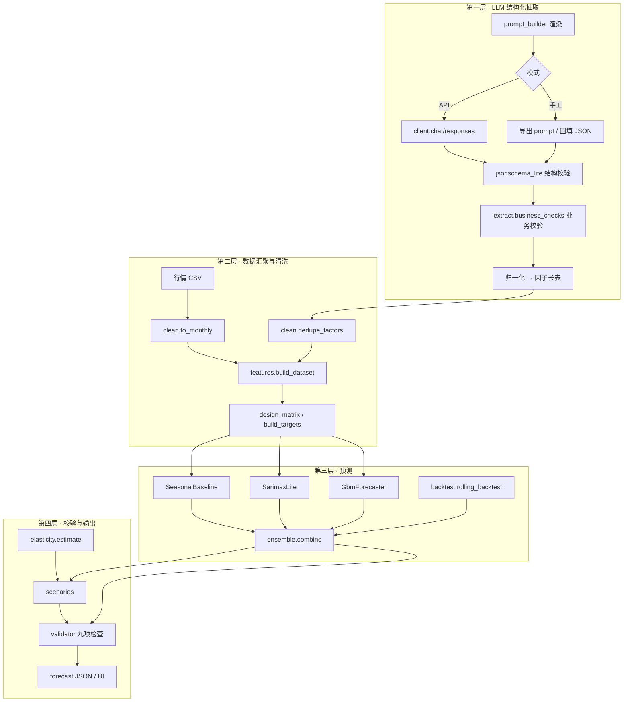

# 架构说明

> 四层结构固定：**LLM 抽取 → 数据汇聚 → 预测模型 → 经济学校验与输出**。
> 不允许跨层直连（例如模型层不得直接调用 HTTP 取数，UI 不得参与任何计算）。

## 1. 分层与职责



| 层 | 模块 | 允许做的事 | 明确禁止 |
|---|---|---|---|
| L1 | `src/llm/*` | 渲染提示词、调用模型、校验与归一化 | 输出价格预测、跳过来源、放宽 schema |
| L2 | `src/data/*` | 聚合、补缺、去噪、单位换算、构造特征 | 使用未来数据、按全样本统计量标准化 |
| L3 | `src/models/*` | 拟合、预测、回测、集成 | 用测试期数据调参、用高频数据建模 |
| L4 | `src/econ/*` | 弹性估计、情景、逻辑校验、告警 | 静默修正异常值、无告警放行 |

## 1.1 数据引导（bootstrap）

```
无数据 ──> init ──> 新浪日线(urllib) ──成功──> 月度聚合 ──> CSV + _meta.json
                       │
                       └─失败─> AKShare(可选) ──成功──> 同上
                                   │
                                   └─失败─> 报错退出（不写任何文件）
```

- **拒绝静默造假**：`allow_demo=False` 时绝不生成合成数据；只有显式 `--allow-demo` 才走合成通道，且 `_meta.json` 标记 `source: demo`，界面可辨识。
- **历史远月价**：按品种的收获月 × 合约周期，取近 4 年 + 未来 2 年的收获季合约（最多 4 个），逐月选「离目标期最近且尚未到期」的合约价；无可用合约时基差置 0 并在 meta 说明。
- **污染隔离**：真实行情落地时，若发现 `data/fundamentals/<id>.csv` 是合成来源（`example.gov.cn/demo`），改名隔离而不是删除，避免「真价格 + 假基本面」混训。

## 2. 数据契约

| 实体 | 文件 | 关键字段 |
|---|---|---|
| 行情 | `data/market/{id}.csv` | `date, close, far_close, volume, open_interest, contract` |
| 因子 | `data/fundamentals/{id}.csv` | `as_of, variety, factor_id, value, unit, period, direction, confidence, source_title, source_url, evidence` |
| 派生 | `data/derived/*.json` | 特征快照、回测、模型摘要 |
| 产物 | `data/output/forecast_{id}.json` | 见附录 A |
| 审计 | `data/output/audit.log` | 每次写入追加一行 JSON |

`close` 为月度主力收盘（现货代理），`far_close` 为收获季对应远月合约收盘。二者之差即基差，作为特征 `basis` 入模。

## 3. 防未来函数：三道闸

1. **可见性闸**：因子只有在 `max(period 所属月末, as_of 发布日) <= 当前月` 时才对当前月可见（`features._factor_monthly`）。
2. **统计量闸**：所有滚动统计使用 **expanding** 窗口（截至 t），包括 z 分数、季节指数、波动率（`_expanding_z` / `_expanding_seasonal`）。
3. **切分闸**：训练集按时间前缀切分；回测逐起点扩张；目标值只取 t 之后的月份。

单元测试 `test_future_price_does_not_change_past_features` 通过「篡改最后一期价格，断言历史特征不变」来守住第 1、2 条。

## 4. 模型细节

### 4.1 季节基准

$$\log P_t = \tau_t + s_{m(t)} + \varepsilon_t$$

- $\tau_t$：12 个月**因果**移动平均（只回看）；
- $s_m$：按日历月对 $(\log P_t-\tau_t)$ 取多年均值，并中心化；
- 外推：$\tau_t + \delta \cdot h + s_{m}$，其中 $\delta$ 为最近一年斜率 × 0.5（阻尼）。

### 4.2 SARIMAX（条件最小二乘）

$$\Delta y_t = c + \sum_{i=1}^{p}\varphi_i \Delta y_{t-i} + \Phi \Delta y_{t-12} + \beta^\top x_{t-1} + e_t$$

- 阶数 `p ∈ [0, p_max]`、季节项 `Φ ∈ {0,1}`，按 **BIC** 选择；
- 外生变量一律滞后 1 期，保证 t 时点只用已发布信息；
- 区间：$\sigma_h = \hat\sigma_{\Delta y}\sqrt{h}$（随机游走式累积），并夹在 [1.5%, 45%]。

### 4.3 GBM（直接多步）

对每个跨度 h 单独训练：目标 $y = \frac{1}{|W|}\sum_{m\in W}\log P_m$，$W$ 为 t+h 附近的收获窗口。

- 后端 A（默认）：直方图分裂 GBRT，深度 3 / 220 树 / lr 0.05 / 行采样 0.85 / 列采样 0.85；
- 后端 B（可选）：`LGBMRegressor`，参数语义一致；
- 区间尺度：前 75% 训练、后 25% 留出验证的残差标准差（训练集残差必然偏小，直接用会系统性过窄）。

### 4.4 集成

$$w_i \propto \frac{1}{\text{MSE}_i},\quad w_i \ge 0.05,\ \sum w_i = 1$$

- MSE 来自滚动回测，且计算每个起点的权重时**只用该起点之前的折**；
- 区间方差：$\sigma^2 = \sum w_i^2\sigma_i^2 + \sum w_i(\mu_i-\mu)^2$（模型内 + 模型间分歧）。

### 4.5 情景（结构弹性）

$$\log P = c + \beta_s S + \beta_d D + \sum_{k=2}^{12}\gamma_k \mathbb{1}[m=k] + \varepsilon$$

- $S$ 为供给松紧指数（产量、库存、面积、单产同向；不利天气反向），$D$ 为需求指数；
- 季节用**月份虚拟变量**吸收，不能用价格自身推导的 `season_idx`（实测会把 $\beta_s$ 压到 0）；
- 情景：$S\pm1\sigma$、$D\mp0.5\sigma$，价格 $= P_0\cdot e^{\Delta}$；
- 符号约束 $\beta_s<0<\beta_d$ 由校验层强制检查。

## 5. 校验矩阵

| ID | 名称 | 触发条件 | 级别 |
|---|---|---|---|
| `price_band` | 价格带 | 超出品种合理带 ±30% | error |
| `interval_width` | 区间宽度 | >75% 或 <2% | warn |
| `probability` | 概率边界 | 上涨概率 <3% 或 >97% | warn |
| `far_month` | 远月定价 | 与远月合约偏离 >18% | warn |
| `season_shape` | 季节形状 | 收获月季节性高于非收获月 | warn |
| `scenario_order` | 情景单调 | 不满足 丰产<平产<减产 | error |
| `mase` | 基准对比 | 集成 MASE ≥ 1 | warn |
| `coverage` / `confidence` / `dropped` | 数据质量 | 因子覆盖 <60%、均值置信 <0.6、有剔除 | warn/info |
| `sample` | 样本长度 | <60 个月 | warn |

`econ.block_on_error=true` 时，出现 error 会阻断结果输出（默认 false，便于研究场景查看异常）。

## 6. 性能与容量

实测（本机 Python 3.14，纯标准库后端，22 品种月度数据，玉米 263 个月）：

| 场景 | 耗时 |
|---|---|
| 单品种回测（8 起点 × 3 跨度）+ 全样本重训 | 4–16 s |
| 全品种批量（22 品种，origins=5） | 约 2.5 分钟 |
| Web 页面首屏（本地服务） | < 200 ms |
| llms-full.txt 生成 | < 0.1 s |

数据量在 MB 级，文件即接口；若扩展到数十品种或日频，建议换 Parquet + DuckDB，`store.py` 为唯一改动点。

## 7. 扩展点

| 想做什么 | 改哪里 |
|---|---|
| 加品种 | `config/varieties.json` + `data/market|fundamentals/{id}.csv` |
| 加因子 | 同文件 `factors` 段 + `schema.json` 的 `factor_id` 枚举 + 提示词调研清单 |
| 换模型 | 实现 `Forecaster.fit/forecast_at`，注册到 `backtest.MODEL_FACTORY` |
| 换数据源 | 实现 `ingest.fetch_*`，保持 `MarketRow` 契约 |
| 换存储 | 只改 `data/store.py` |
| 换前端 | 保持 `/api/*` JSON 契约即可 |

## 8. 已知局限

- 月度样本量小（10 年 = 120 点），参数估计方差大，长跨度区间天然偏宽；
- 合成数据只用于流程验证，其统计特性与真实市场不同，勿据此判断模型在实盘的精度；
- 期货主力连续不处理换月跳空（真实使用应做后复权或价差调整）；
- 未建模政策突变、疫病、极端天气等结构断点，只能通过情景与告警提示；
- 单一商品、单一时点，不具备跨品种套利或组合优化能力（不在本项目范围）。

## 附录 A：`forecast_{id}.json` 结构

```jsonc
{
  "schema_version": "1.0.0",
  "generated_at": "2026-11-21T17:47:00",
  "variety": {"id":"corn","name":"玉米","ticker":"C","unit":"元/吨","harvest_months":[9,10,11]},
  "as_of_month": "2026-11",
  "far_close": 2560.0,
  "headline": {
    "horizon_months": 6, "target_months": ["2027-09","2027-10","2027-11"],
    "price": 2361.32, "lo": 2133.32, "hi": 2613.7, "interval_level": 0.8,
    "prob_up": 12.4, "expected_change_pct": -8.76,
    "weights": {"gbm":0.44,"sarimax":0.34,"seasonal_baseline":0.22},
    "models": [{"name":"gbm","price":2340.1,"lo":...,"hi":...,"sigma":0.06,"weight":0.44,"diagnostics":{}}],
    "metrics": {"ensemble": {"mae":56,"rmse":62,"mase":0.451,"coverage":100.0}},
    "best_model": "gbm", "ranking": ["gbm","ensemble","sarimax","seasonal_baseline"]
  },
  "horizons": {"6": {...}, "9": {...}, "12": {...}},
  "scenarios": [{"key":"bumper","label":"丰产","price":2280.4,"change_pct":-3.4,"prob_up":30.1}],
  "seasonal_profile": [{"month":1,"index":-0.02,"pct":-1.9}],
  "validation": {"status":"pass","checks":[{"id":"price_band","level":"info","message":"..."}]},
  "residual": {"n":8,"mean":-26.8,"sd":61.3,"dw":2.07,"ljung_box_p":0.43,"series":[...]},
  "sensitivity": [{"input_shift_pct":-10,"price":2125.2}],
  "elasticity": {"beta_supply":-0.0224,"t_supply":-3.53,"beta_demand":0.0066,"sign_ok":true},
  "history": [{"month":"2018-01","close":2300.0,"far_close":2280.0}],
  "logs": [{"level":"warn","msg":"..."}]
}
```
